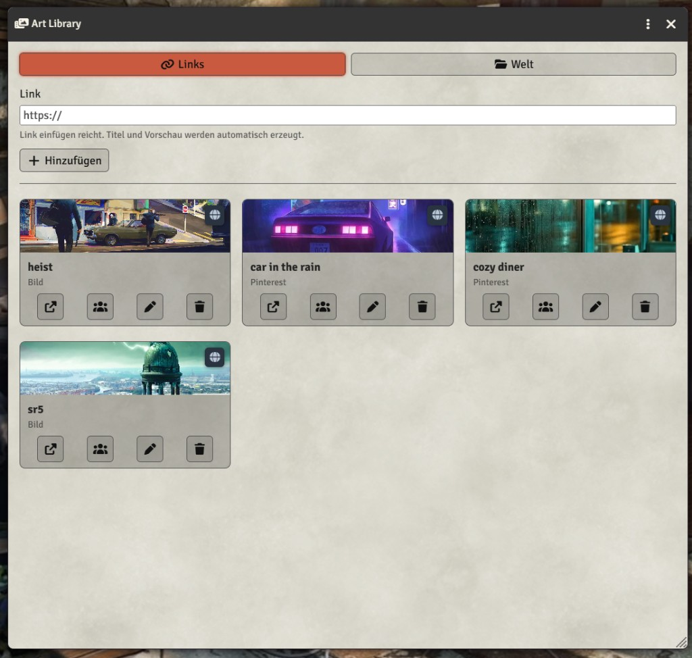

# Art Library

A Foundry VTT module with a **GM-only art library**. Keep image, video and Pinterest links (no upload required) and open them in a resizable window for yourself, selected players, or the whole table. You can also post an image to chat or turn it into a Foundry scene.

The module is not tied to a game system. It has only been tested with SWADE, but it should work with other systems as well.



## What you can share

- Direct image URLs (`.jpg`, `.png`, `.webp`, …)
- Direct video URLs (`.mp4`, `.webm`, …)
- YouTube links
- [Pinterest pins](https://www.pinterest.com/) as a still image (including video pins)

Pinterest pin pages are websites, not image files. The module tries to load the pin image. If Pinterest blocks that, a clipped embed is used instead.

## Usage

The GM opens the library from the **scene controls** (photo/film icon) or:

```js
game.modules.get("art-library").api.openLibrary();
```

Paste a link. Title (from Pinterest when available) and a preview from the same link are created automatically. You can rename an entry afterwards. Players never see the library; they only see windows or chat messages you send them.

The **World** tab browses image files in the current world's folder (`worlds/<world-id>/`), using the same directory structure as Foundry. Open, share or turn a file into a scene without adding it to the link library.

### Open vs share

- **Open** shows the art in a window **only for you**. Other players see nothing.
- **Share** opens a dialog (same idea as Nik's Show & Tell):
  - **Show to all** — popup window for every player
  - **Show to selected** — popup only for the checked players (one or several)
  - **Send to chat** — posts the image in chat instead of a popup. With players checked it whispers; with none checked it goes to everyone. An optional caption is used only for chat.

The viewer header menu offers the same **Share** dialog and **Close for all players**.

### Create as scene

On still images and Pinterest pins, **Create as scene** makes a gridless Foundry scene. Remote hosts such as Pinterest and many CDNs block the canvas (CORS), so the module copies the file into `worlds/<world-id>/art-library/` and sets that local path as the **Initial Level** background.

If a direct download is blocked, it tries an image proxy, then asks you to paste or drop the image (right-click → Copy image). The local path is remembered on the library entry for the next scene.

## API

```js
const api = game.modules.get("art-library").api;

api.open("Item name or id");                      // for yourself
api.open("Item name", { userId: someUser.id });   // GM: for a specific user
api.open("Item name", { userIds: [idA, idB] });   // GM: for several users
api.openForAll("Item name");                      // GM: window for everyone
api.share("Item name");                           // GM: share dialog
api.postToChat("Item name", { caption: "Look." });
api.closeForAll("Item name");
api.add({ name: "Neon poster", url: "https://..." });
```

## Installation

To install, import this manifest into the module browser.

**Manifest URL:**
`https://raw.githubusercontent.com/ivan-hr/art-library/main/module.json`

## Requirements

- Foundry VTT v13 or newer (verified on v14)

## License

MIT
