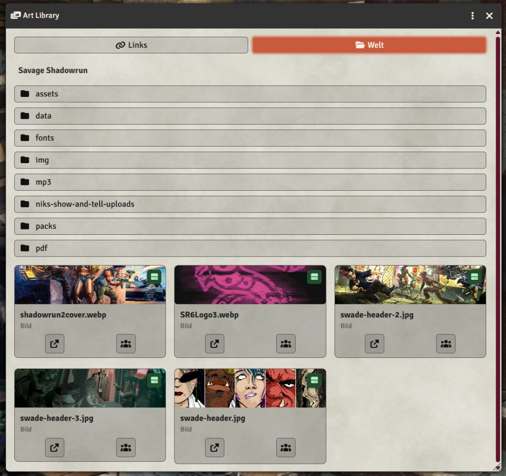
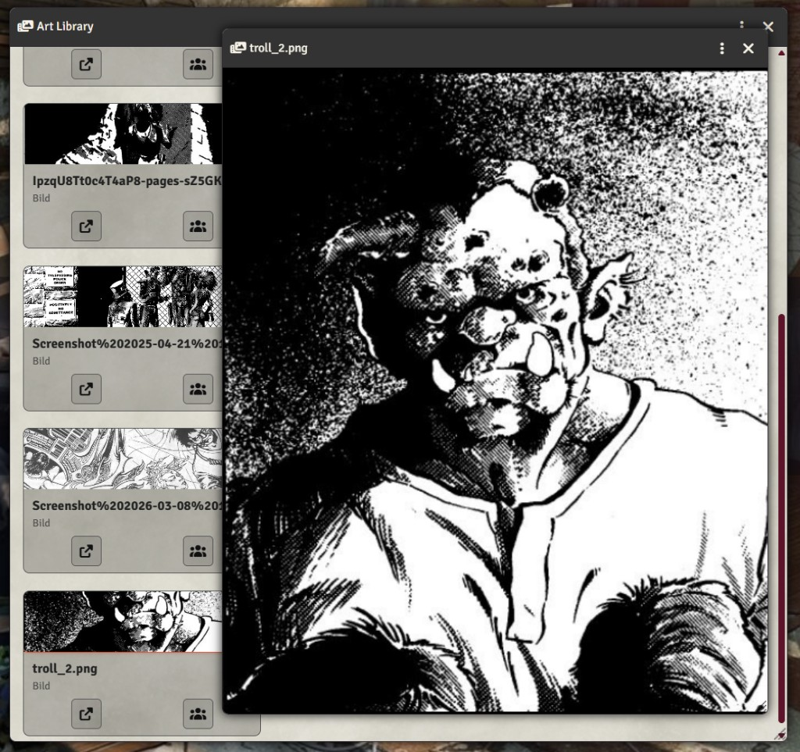

# Art Library

A Foundry VTT module with a **GM-only art library**. Keep image, video and Pinterest links (no upload required) and open them in a resizable window for yourself, one player, or the whole table.

The module is not tied to a game system. It has only been tested with SWADE, but it should work with other systems as well.





## What you can share

- Direct image URLs (`.jpg`, `.png`, `.webp`, …)
- Direct video URLs (`.mp4`, `.webm`, …)
- YouTube and Vimeo links
- [Pinterest pins](https://www.pinterest.com/) as a still image (including video pins)

Pinterest pin pages are websites, not image files. The module tries to load the pin image. If Pinterest blocks that, a clipped embed is used instead.

## Usage

The GM opens the library from the **scene controls** (photo/film icon) or:

```js
game.modules.get("art-library").api.openLibrary();
```

Paste a link. Title (from Pinterest when available) and a preview from the same link are created automatically. You can rename an entry afterwards. Players never see the library; they only see windows you open for them.

The **World** tab browses image files in the current world's folder (`worlds/<world-id>/`), using the same directory structure as Foundry. Open or share a file without adding it to the link library.

```js
const api = game.modules.get("art-library").api;

api.open("Item name or id");                      // for yourself
api.open("Item name", { userId: someUser.id });   // GM: for a specific user
api.openForAll("Item name");                      // GM: for everyone
api.closeForAll("Item name");
api.add({ name: "Neon poster", url: "https://..." });
```

The viewer header menu lets the GM **Share with all players** or **Close for all players**.

## Installation

To install, import this manifest into the module browser.

**Manifest URL:**
`https://raw.githubusercontent.com/ivan-hr/art-library/main/module.json`

## Requirements

- Foundry VTT v13 or newer (verified on v14)

## License

MIT
